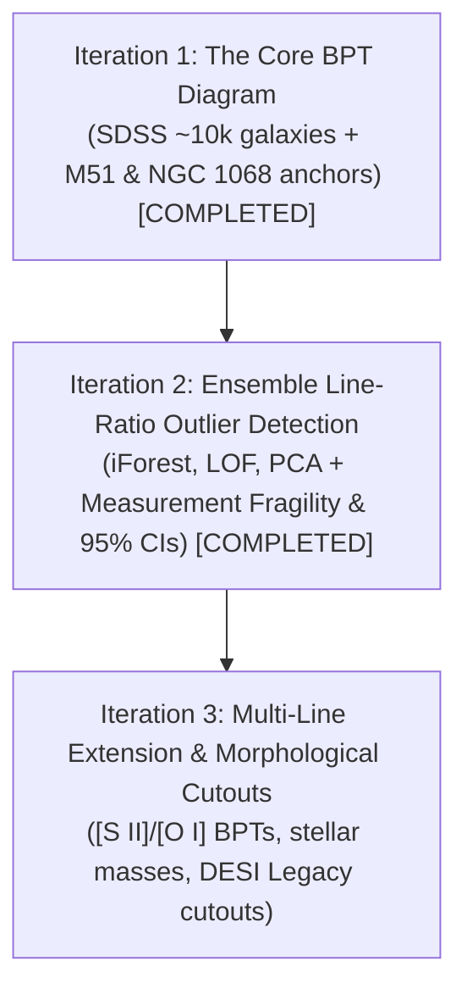

# Project Plan: `bpt-diagram-sdss`
### *Mapping the Cosmic Boundary: Starburst Galaxies vs. Accreting Black Holes (SDSS DR17)*

## 1. Executive Summary

This project implements the **Baldwin, Phillips & Terlevich (BPT, 1981)** emission-line diagnostic diagram using real spectroscopic survey data from the **Sloan Digital Sky Survey (SDSS)**.

The scientific goal is to classify galaxies based on the physical source of their ionizing radiation:
* **Star-Forming Galaxies:** Gas photoionized by ultraviolet radiation from young, massive OB stars in stellar nurseries.
* **Active Galactic Nuclei (AGN, e.g. NGC 1068, M51 nucleus):** Gas photoionized by hard power-law radiation from supermassive black hole accretion disks.
* **Composites & LINERs:** Intermediate systems undergoing both starbursts and black-hole feedback, or low-ionization shock excitation.

---

## 2. Astrophysics & Mathematical Foundations

The BPT diagram relies on two optical emission line flux ratios:
* **y-axis:** **log₁₀([O III] λ5007 / Hβ)** — tracks the ionization parameter and radiation hardness.
* **x-axis:** **log₁₀([N II] λ6584 / Hα)** — tracks gas metallicity and nitrogen abundance.

### Demarcation Boundaries
1. **Kauffmann et al. (2003) Empirical Star-Formation Line:**
   ```text
   log₁₀([O III] / Hβ) = 0.61 / (log₁₀([N II] / Hα) - 0.05) + 1.30
   ```
   Galaxies below this curve are cleanly star-forming.

2. **Kewley et al. (2001) Theoretical Extreme Starburst Upper Limit:**
   ```text
   log₁₀([O III] / Hβ) = 0.61 / (log₁₀([N II] / Hα) - 0.47) + 1.19
   ```
   Galaxies above this curve cannot be explained by starbursts alone; they require supermassive black hole accretion (AGN) or shocks.

3. **Composite Transition Region:**
   Galaxies between the Kauffmann (2003) and Kewley (2001) lines are composite systems (starburst + AGN contribution).

---

## 3. Iteration Breakdown



### Iteration 1: The Core BPT Diagnostic [Completed]
* Query SDSS DR17 / MPA-JHU catalog for $\sim 10,000$ galaxies with $0.02 < z < 0.25$.
* Enforce line signal-to-noise quality cut ($S/N \ge 3$ on $\text{H}\alpha, \text{H}\beta, [\text{N II}], [\text{O III}]$ after MPA-JHU error rescaling).
* Plot 2D density/hexbin distribution showing the characteristic two-pronged distribution.
* Overlay anchor galaxies from Ho, Filippenko & Sargent (1997): **M51** (Seyfert 2 nucleus) and **NGC 1068** (Seyfert 2).

### Iteration 2: Ensemble line-ratio outlier detection [Completed]
* **Ensemble:** Isolation Forest + Local Outlier Factor ($k=35$) + PCA Reconstruction Residuals.
* **Equal-Weighted Voting:** Calibrated percentile ranks (0–100) + consensus score + algorithm votes (3/3, 2/3).
* **Measurement Fragility:** Analytical Gaussian error propagation for $\sigma_{\log([\text{N II}]/\text{H}\alpha)}$ and $\sigma_{\log([\text{O III}]/\text{H}\beta)}$, 2-D 95% Confidence Interval error ellipses ($2.448\sigma$).
* **Scores:** Heuristic `measurement_fragility` (0–1) and `quality_weighted_outlier_score` (0–100).
* **Candidate Catalog:** Ranked outlier candidates exported to `data/sdss_anomaly_candidates.csv` and cross-matched against SIMBAD via `src/crossmatch.py`.
* **Figure:** `assets/bpt_anomalies_sdss.png` displaying 95% CI error ellipses distinguishing low-fragility candidates from high-fragility noisy measurements.

### Iteration 3: Physical Correlates & Visual Cutouts
* Incorporate $[\text{S II}]\,\lambda\lambda 6717,6731$ and $[\text{O I}]\,\lambda 6300$ line diagnostics.
* Color-code distribution by galaxy stellar mass ($M_*$) and redshift ($z$).
* Retrieve direct multi-band optical image cutouts from the **DESI Legacy Imaging Surveys** for candidate systems.

---

## 4. Repository & File Structure

```text
bpt-diagram-sdss/
├── README.md               # Scientific documentation & observational results
├── PLAN.md                 # Architecture & technical plan
├── CITATION.cff            # Citation metadata (cff 1.2.0)
├── REFERENCES.bib          # NASA/ADS BibTeX database with verified DOIs
├── NOTES.md                # Working notes and decisions
├── LICENSE                 # MIT License
├── .gitignore              # Ignores large raw files, pycache, .venv/
├── requirements.txt        # astropy, astroquery, pandas, matplotlib, numpy, scikit-learn
├── src/
│   ├── query_data.py       # SDSS DR17 SQL query & local caching (CSV)
│   ├── bpt_math.py         # Kauffmann & Kewley mathematical boundaries and MPA-JHU validation
│   ├── plot_bpt.py         # Matplotlib 2D density hexbin plot
│   ├── glitch_filter.py    # Analytical error propagation, 2-D error ellipses, fragility score
│   ├── anomaly_detector.py # Isolation Forest, LOF, PCA residual ensemble and stability analysis
│   ├── crossmatch.py       # Automated SIMBAD cross-match resolver
│   └── plot_anomalies.py   # Anomaly diagnostic map with 2-D error ellipses
├── assets/
│   ├── bpt_diagnostic_sdss.png # Classical BPT diagram
│   └── bpt_anomalies_sdss.png  # Outlier detection diagnostic map
├── data/
│   ├── sdss_bpt_sample.csv                  # Tracked sample of 10,000 SDSS galaxies
│   ├── sdss_anomaly_candidates.csv          # Outlier candidates catalog
│   ├── sdss_anomaly_candidates_simbad.csv   # SIMBAD cross-match results
│   ├── classifier_validation.csv            # MPA-JHU bptclass comparison
│   ├── anomaly_stability.csv                # 15-run stability analysis
│   └── anchor_galaxies.json                 # Palomar HFS97 nuclear ratios
└── run_bpt.py              # Master pipeline runner
```

---

## 5. Security & Privacy Commitments
* Zero local file paths (`/Users/...`) or username references.
* No API tokens or passwords required (SDSS and Legacy Surveys are public open-access archives).
* Hardened `.gitignore` to prevent multi-gigabyte survey downloads or secrets from leaking into Git.
