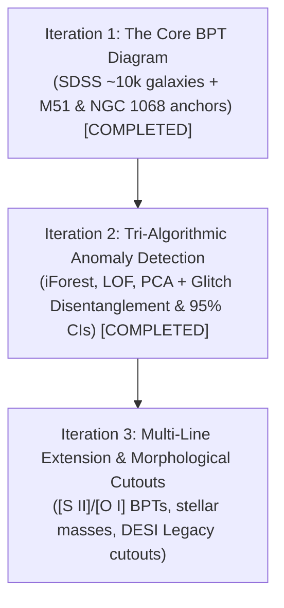

# Project Plan: `bpt-diagram-sdss`
### *Mapping the Cosmic Boundary: Starburst Galaxies vs. Accreting Black Holes (SDSS DR17)*

## 1. Executive Summary

This project implements the landmark **Baldwin, Phillips & Terlevich (BPT, 1981)** emission-line diagnostic diagram using real spectroscopic survey data from the **Sloan Digital Sky Survey (SDSS)**.

The scientific goal is to classify galaxies based on the physical source of their ionizing radiation:
* **Star-Forming Galaxies (e.g. M51):** Gas photoionized by ultraviolet radiation from young, massive OB stars in stellar nurseries.
* **Active Galactic Nuclei (AGN, e.g. NGC 1068):** Gas photoionized by extreme hard power-law radiation from supermassive black hole accretion disks.
* **Composites & LINERs:** Intermediate systems undergoing both starbursts and black-hole feedback, or low-ionization shock excitation.

---

## 2. Astrophysics & Mathematical Foundations

The BPT diagram relies on two optical emission line flux ratios:
* **y-axis:** **log₁₀([O III] λ5007 / Hβ)** — tracks the ionization parameter and radiation hardness.
* **x-axis:** **log₁₀([N II] λ6584 / Hα)** — tracks gas metallicity and nitrogen abundance.

### Demarcation Boundaries
1. **Kauffmann et al. (2003) Empirical Star-Formation Line:**
   ```text
   log₁₀([O III] / Hβ) = 0.61 / (log₁₀([N II] / Hα) - 0.05) + 1.30
   ```
   Galaxies below this curve are cleanly star-forming.

2. **Kewley et al. (2001) Theoretical Extreme Starburst Upper Limit:**
   ```text
   log₁₀([O III] / Hβ) = 0.61 / (log₁₀([N II] / Hα) - 0.47) + 1.19
   ```
   Galaxies above this curve cannot be explained by starbursts alone; they require supermassive black hole accretion (AGN).

3. **Composite Transition Region:**
   Galaxies between the Kauffmann (2003) and Kewley (2001) lines are composite systems (starburst + AGN contribution).

---

## 3. Iteration Breakdown



### Iteration 1: The Core BPT Diagnostic [Completed]
* Query SDSS DR17 / MPA-JHU catalog for $\sim 10,000$ galaxies with $0.02 < z < 0.25$.
* Enforce line signal-to-noise quality cut ($S/N \ge 3$ on $\text{H}\alpha, \text{H}\beta, [\text{N II}], [\text{O III}]$).
* Plot 2D density/hexbin distribution showing the characteristic two-pronged "seagull" wings.
* Overlay anchor galaxies: **M51** (Star-Forming) and **NGC 1068** (Seyfert AGN).

### Iteration 2: Tri-Algorithmic Anomaly Detection & Glitch Disentanglement [Completed]
* **Tri-Ensemble:** Isolation Forest + Local Outlier Factor (k=35) + PCA Reconstruction Residuals.
* **Equal-Weighted Voting:** Calibrated percentile ranks (0–100) + consensus score + algorithm votes (3/3, 2/3).
* **Glitch Disentanglement:** Analytical Gaussian error propagation for σ_log([N II]/Hα) and σ_log([O III]/Hβ), 95% Confidence Interval ellipses.
* **Scores:** Scaled `pipeline_glitch_risk` (0–100) and `physical_anomaly_confidence` (0–100).
* **Candidate Catalog:** Top 20 ranked physical celestial anomalies exported to `data/sdss_anomaly_candidates.csv` with SDSS SkyServer and DESI Legacy Survey links.
* **Figure:** `assets/bpt_anomalies_sdss.png` displaying 95% CI error ellipses distinguishing real anomalies from wide-jitter glitches.

### Iteration 3: Physical Correlates & Visual Cutouts
* Incorporate $[\text{S II}]\,\lambda\lambda 6717,6731$ and $[\text{O I}]\,\lambda 6300$ line diagnostics.
* Color-code distribution by galaxy stellar mass ($M_*$) and redshift ($z$).
* Retrieve direct multi-band optical image cutouts from the **DESI Legacy Imaging Surveys** for top candidate systems.

---

## 4. Repository & File Structure

```text
bpt-diagram-sdss/
├── README.md               # Standalone publication-grade scientific portfolio
├── PLAN.md                 # This architecture & technical plan
├── LICENSE                 # MIT License
├── .gitignore              # Excludes data/ FITS caches, .venv/, and secrets
├── requirements.txt        # astropy, astroquery, matplotlib, numpy, scipy
├── src/
│   ├── query_data.py       # SDSS DR17 SQL query & local caching (parquet/fits)
│   ├── bpt_math.py         # Kauffmann & Kewley mathematical boundary functions
│   ├── classify.py         # Category assignment (Star-forming, Composite, AGN)
│   └── plot_bpt.py         # Matplotlib 2D density & cutout generator
├── assets/
│   └── bpt_diagram.png     # Publication-quality final figure
└── run_bpt.py              # End-to-end reproducible pipeline runner
```

---

## 5. Security & Privacy Commitments
* Zero local file paths (`/Users/...`) or username references.
* No API tokens or passwords required (SDSS and Legacy Surveys are public open-access archives).
* Hardened `.gitignore` to prevent multi-gigabyte survey downloads or secrets from leaking into Git.
