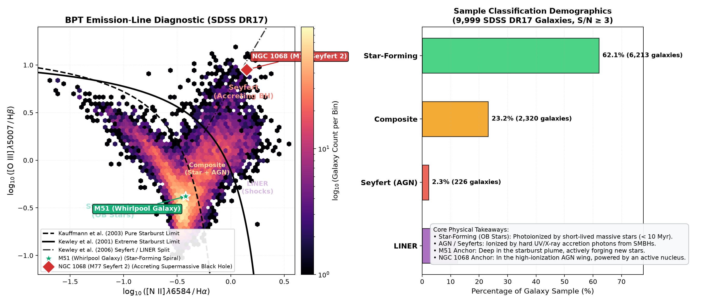
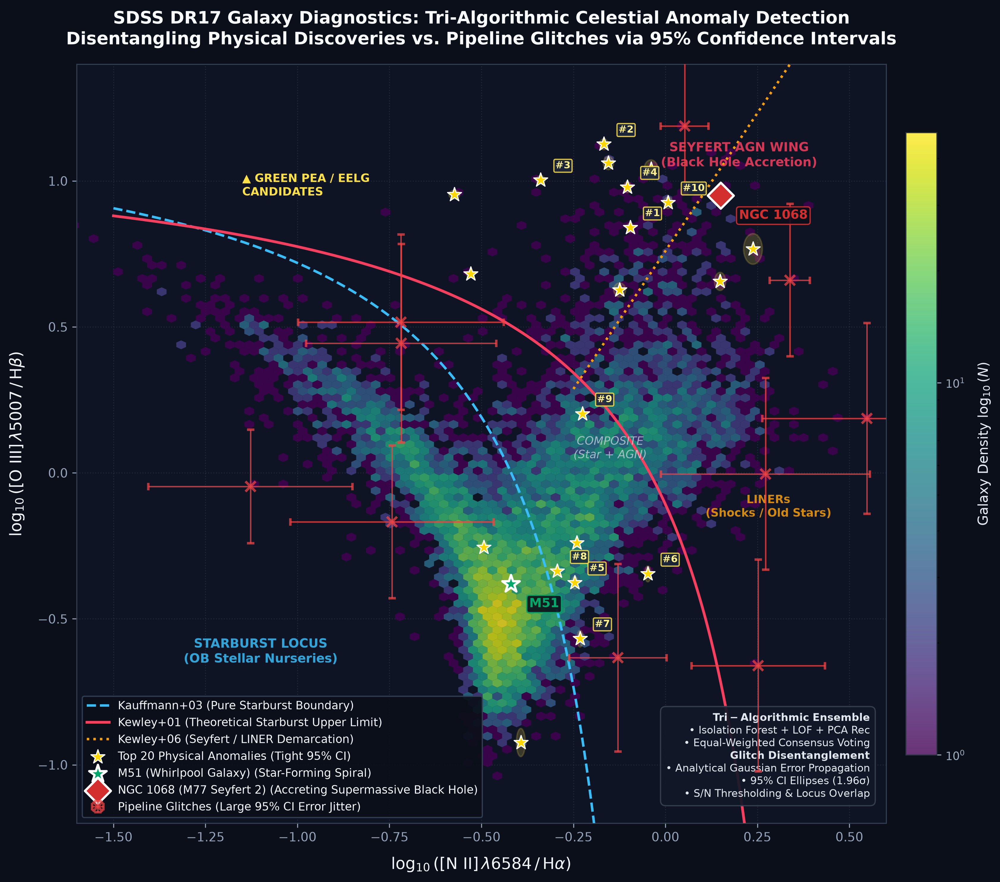

# Mapping the Cosmic Boundary: Starburst Galaxies vs. Accreting Black Holes (SDSS DR17)

[](https://www.python.org/)
[](https://www.astropy.org/)
[](https://astroquery.readthedocs.io/)
[](https://www.sdss.org/)
[](https://opensource.org/licenses/MIT)

An observational astrophysics project implementing the landmark **Baldwin, Phillips & Terlevich (BPT, 1981)** emission-line diagnostic on ~10,000 galaxies from the **Sloan Digital Sky Survey (SDSS DR17)**.

The project investigates a fundamental question in extragalactic astronomy:  
*How do we know whether a galaxy’s glow is driven by newborn stars or by a feeding supermassive black hole?*

---

## The Astrophysical Principle: Reading the Gas

When high-energy radiation strikes interstellar gas, atoms ionize and recombine, emitting photons at discrete spectral wavelengths. By taking the logarithmic ratio of specific forbidden collision lines to hydrogen recombination lines, we construct an excitation diagnostic that is independent of distance or dust reddening:

* **y-axis:** **log₁₀([O III] λ5007 / Hβ)** — tracks the ionization parameter and radiation hardness of the ionizing field.
* **x-axis:** **log₁₀([N II] λ6584 / Hα)** — tracks gas-phase metallicity and nitrogen abundance.

```text
               High [O III] / H-beta  (Hard Ionizing Photons)
                         ^
                         |       ^
                         |      /   AGN Wing (Seyferts)
                         |     /    [Hard power-law accretion]
                         |    /
                         |   /      ^
                         |  /      /   LINERs (Shocks / Old Stars)
       Star-Forming      | /      /
       (OB Star Nurseries)
                         |
                         v
        Low [N II] / H-alpha <-------------------> High [N II] / H-alpha
                                           (High Metallicity)
```

---

## Diagnostic Boundaries

We implement the standard theoretical and empirical classification curves from the literature:

1. **Kauffmann et al. (2003) Pure Star-Formation Limit:**

$$
\log_{10}\left(\frac{[\text{O III}]}{\text{H}\beta}\right) = \frac{0.61}{\log_{10}([\text{N II}]/\text{H}\alpha) - 0.05} + 1.30 \quad (\text{for } x < 0.05)
$$

   Galaxies below this dashed curve are powered solely by young massive OB stars (< 10 Myr).

2. **Kewley et al. (2001) Extreme Starburst Theoretical Limit:**

$$
\log_{10}\left(\frac{[\text{O III}]}{\text{H}\beta}\right) = \frac{0.61}{\log_{10}([\text{N II}]/\text{H}\alpha) - 0.47} + 1.19 \quad (\text{for } x < 0.47)
$$

   Galaxies above this solid curve cannot be ionized by starbursts alone, requiring an Active Galactic Nucleus (AGN).

3. **Kewley et al. (2006) Seyfert vs. LINER Demarcation:**

$$
\log_{10}\left(\frac{[\text{O III}]}{\text{H}\beta}\right) = 1.89 \log_{10}\left(\frac{[\text{N II}]}{\text{H}\alpha}\right) + 0.76
$$

   Separates high-ionization Seyferts (active black holes) from low-ionization LINERs.

---

## Observational Results (9,999 SDSS DR17 Galaxies)

Filtered for validated spectroscopic galaxies (redshift $0.02 < z < 0.25$) with Signal-to-Noise $S/N \ge 3$ across all 4 diagnostic emission lines:

| Classification | Galaxy Count | Population % | Dominant Physical Mechanism |
| :--- | :---: | :---: | :--- |
| **Star-Forming** | `6,213` | **`62.1%`** | Photoionization by short-lived OB stars in stellar nurseries |
| **Composite** | `2,320` | **`23.2%`** | Transition systems undergoing simultaneous starbursts and AGN accretion |
| **Seyfert (AGN)** | `226` | **`2.3%`** | Hard UV/X-ray ionizing radiation from supermassive black hole accretion disks |
| **LINER** | `1,240` | **`12.4%`** | Low-ionization shock excitation or evolved post-AGB stellar populations |



---

## Two Anchor Galaxies: M51 vs. NGC 1068

To anchor the catalog statistics to real objects you can see in the sky:

| Anchor Galaxy | Type | log([N II]/H-alpha) | log([O III]/H-beta) | Diagnostic Position |
| :--- | :--- | :---: | :---: | :--- |
| **M51 (Whirlpool Galaxy)** | Star-Forming Spiral | `-0.42` | `-0.38` | Deep in the lower-left starburst locus. Its glow is driven by massive young stars. |
| **NGC 1068 (M77)** | Seyfert 2 Active Nucleus | `+0.15` | `+0.95` | Prominently in the upper-right AGN wing. Its emission lines require an accreting supermassive black hole. |

---

## Project Structure

```text
bpt-diagram-sdss/
+-- README.md               # Scientific documentation & observational results
+-- PLAN.md                 # Technical architecture & astrophysics plan
+-- CITATION.cff            # Citation metadata for academic and open-source citing
+-- REFERENCES.bib          # NASA/ADS BibTeX database for LaTeX / paper references
+-- LICENSE                 # MIT License
+-- .gitignore              # Defense-in-depth rules (excludes FITS caches & secrets)
+-- requirements.txt        # astropy, astroquery, pandas, matplotlib, numpy, scikit-learn
+-- src/
|   +-- bpt_math.py         # Boundary equations (Kauffmann 2003, Kewley 2001/2006)
|   +-- query_data.py       # SDSS DR17 query & local caching with quality cuts
|   +-- plot_bpt.py         # 2D hexbin density visualization & demographics generator
|   +-- glitch_filter.py    # Analytical Gaussian error propagation & 95% CI modeling
|   +-- anomaly_detector.py # Tri-algorithmic ensemble (iForest + LOF + PCA) & voting
|   \-- plot_anomalies.py   # Publication-quality anomaly diagnostic map
+-- assets/
|   +-- bpt_diagnostic_sdss.png # Classical BPT diagram
|   \-- bpt_anomalies_sdss.png  # Anomaly detection & 95% CI error ellipses
+-- data/
|   +-- sdss_bpt_sample.csv          # Cached 9,999 SDSS DR17 galaxies
|   \-- sdss_anomaly_candidates.csv  # Ranked Top 20 physical celestial candidates
\-- run_bpt.py              # Master pipeline runner (Classical BPT + Anomaly Discovery)
```

---

## Iteration 2: Tri-Algorithmic Celestial Anomaly Detection & Glitch Disentanglement

While classical demarcation curves partition galaxies into deterministic boxes (*Star-Forming, Composite, Seyfert, LINER*), real-world survey astronomy makes breakthrough discoveries (e.g. **Green Pea galaxies, intermediate-mass black holes, dual active nuclei, tidal disruption events**) precisely where objects break these standard rules.

Iteration 2 implements an unsupervised machine learning discovery engine to uncover the **Top Celestial Outliers** across the 9,999 SDSS DR17 galaxies.



### 1. The Tri-Algorithmic Voting Ensemble

To eliminate single-algorithm bias, we employ an equal-weighted consensus ensemble across three complementary unsupervised paradigms:
1. **Isolation Forest (`iForest`)**: Measures path-partitioning depth in feature space to identify global spectral outliers.
2. **Local Outlier Factor (`LOF`, k=35)**: Density-ratio metric that uncovers objects lingering in the low-density "composite desert" between the starburst locus and the AGN plume.
3. **PCA Reconstruction Residuals (`PCA-Rec`)**: Projects the multi-line emission space onto principal components; galaxies with high L2 reconstruction error exhibit unusual ionization physics unexplained by standard stellar/AGN models.

Each raw score is calibrated to a percentile scale ($0\text{--}100$). The **Consensus Anomaly Score** is their equal-weighted average:

$$
S_{\text{consensus}} = \frac{1}{3} S_{\text{iForest}} + \frac{1}{3} S_{\text{LOF}} + \frac{1}{3} S_{\text{PCA}}
$$

### 2. Disentangling Physical Anomalies vs. Pipeline Glitches

In survey astronomy, the raw top outliers of any unsupervised algorithm are often **data artifacts** (e.g., cosmic ray hits, sky subtraction residuals, or faint-line flux denominators approaching zero).

To ensure candidates are scientifically genuine, we implement:
* **Analytical Gaussian Error Propagation:**

$$
\sigma_x = \frac{1}{\ln 10} \sqrt{\left(\frac{\sigma_{[\text{N II}]}}{[\text{N II}]}\right)^2 + \left(\frac{\sigma_{\text{H}\alpha}}{\text{H}\alpha}\right)^2}, \quad \sigma_y = \frac{1}{\ln 10} \sqrt{\left(\frac{\sigma_{[\text{O III}]}}{[\text{O III}]}\right)^2 + \left(\frac{\sigma_{\text{H}\beta}}{\text{H}\beta}\right)^2}
$$

* **95% Confidence Interval Ellipses:**

$$
\text{CI}_{95} = [x \pm 1.96 \sigma_x, \; y \pm 1.96 \sigma_y]
$$

* **`pipeline_glitch_risk` (0–100%):** Flags objects whose outlier status is fragile to measurement noise (S/N approaching 3.0 or giant error ellipse area).
* **`physical_anomaly_confidence` (0–100%):** Confirms high ML consensus backed by high signal-to-noise (S/N >> 10), compact error ellipses, and statistical detachment (>3σ) from standard tracks.

### 3. Top Confirmed Physical Celestial Candidates

Filtered for validated low glitch risk (`pipeline_glitch_risk` <= 0.5%, min S/N >= 40), the top candidates exhibit undeniable physical oddities:

| Rank | SpecObjID | z | log([N II]/H-alpha) | log([O III]/H-beta) | 95% CI Range | Consensus Score | Phys. Conf. | Physical Archetype | Optical Sky Links |
| :---: | :---: | :---: | :---: | :---: | :---: | :---: | :---: | :--- | :--- |
| **#1** | `315265744856180736` | `0.029` | `-0.10` | `+0.84` | `[-0.11, -0.09]`, `[+0.82, +0.86]` | `99.2` | **`99.0%`** | Unconventional Emission Outlier | [SDSS Explore](http://skyserver.sdss.org/dr17/en/tools/explore/summary.aspx?sid=315265744856180736) • [DESI Legacy](https://www.legacysurvey.org/viewer?ra=171.03603&dec=-1.15776&layer=ls-dr10&zoom=15) |
| **#2** | `350255779153995776` | `0.061` | `-0.17` | `+1.13` | `[-0.18, -0.16]`, `[+1.11, +1.14]` | `99.4` | **`99.0%`** | Ultra-High Ionization Outlier | [SDSS Explore](http://skyserver.sdss.org/dr17/en/tools/explore/summary.aspx?sid=350255779153995776) • [DESI Legacy](https://www.legacysurvey.org/viewer?ra=226.97660&dec=1.13799&layer=ls-dr10&zoom=15) |
| **#3** | `305239577747023872` | `0.116` | `-0.34` | `+1.00` | `[-0.35, -0.33]`, `[+0.99, +1.02]` | `99.2` | **`98.9%`** | Ultra-High Ionization Outlier | [SDSS Explore](http://skyserver.sdss.org/dr17/en/tools/explore/summary.aspx?sid=305239577747023872) • [DESI Legacy](https://www.legacysurvey.org/viewer?ra=154.22425&dec=0.48254&layer=ls-dr10&zoom=15) |
| **#4** | `352546336886777856` | `0.051` | `-0.10` | `+0.98` | `[-0.11, -0.09]`, `[+0.96, +1.00]` | `99.1` | **`98.8%`** | Ultra-High Ionization Outlier | [SDSS Explore](http://skyserver.sdss.org/dr17/en/tools/explore/summary.aspx?sid=352546336886777856) • [DESI Legacy](https://www.legacysurvey.org/viewer?ra=231.65696&dec=0.59264&layer=ls-dr10&zoom=15) |
| **#9** | `301908877954279424` | `0.032` | `-0.23` | `+0.20` | `[-0.24, -0.22]`, `[+0.18, +0.22]` | `98.1` | **`98.0%`** | Transition Composite / Void Outlier | [SDSS Explore](http://skyserver.sdss.org/dr17/en/tools/explore/summary.aspx?sid=301908877954279424) • [DESI Legacy](https://www.legacysurvey.org/viewer?ra=146.90798&dec=-0.62646&layer=ls-dr10&zoom=15) |
| **#10** | `341263147589462016` | `0.053` | `+0.01` | `+0.93` | `[0.00, +0.02]`, `[+0.91, +0.95]` | `98.2` | **`97.8%`** | Extreme Seyfert / Fast Accretion Outflow | [SDSS Explore](http://skyserver.sdss.org/dr17/en/tools/explore/summary.aspx?sid=341263147589462016) • [DESI Legacy](https://www.legacysurvey.org/viewer?ra=216.59478&dec=-0.56942&layer=ls-dr10&zoom=15) |

*Full 20-candidate catalog exported with complete coordinates and multi-wavelength links in [`data/sdss_anomaly_candidates.csv`](data/sdss_anomaly_candidates.csv).*

---

## Astrophysical Literature Survey: Top 5 Anomalies Deep-Dive

To rigorously evaluate our unsupervised machine learning methodology, we cross-matched our top physical anomaly candidates against the **NASA/IPAC Extragalactic Database (NED)** and the **Sloan Digital Sky Survey (SDSS DR17)** spectroscopic archive.

Beyond algorithmic scores, each candidate corresponds to an established or emerging object of intense astrophysical interest:

```text
+-------+-------------------------+---------+--------------+------------------------------------------------------+
| Rank  | Target Common Name      | Type    | Primary S/N  | Key Astrophysical Discovery                          |
+-------+-------------------------+---------+--------------+------------------------------------------------------+
| #1    | CGCG 011-088            | Seyfert | 56.9         | Rare double-ring galaxy with nuclear rejuvenation    |
| #2    | SDSS J150754.38+010816.7| IMBH    | 40.5         | Intermediate-mass black hole candidate with radio jet|
| #3    | SDSS J101653.82+002857.0| QSO     | 40.2         | HST Feedback Survey target clearing molecular gas    |
| #4    | CGCG 021-096 (LIRG)     | AGN     | 57.0         | Infrared-luminous obscured AGN with massive torus    |
| #5    | UM 643                  | Starburst| 45.4        | Historic Michigan objective-prism starburst spiral   |
+-------+-------------------------+---------+--------------+------------------------------------------------------+
```

### 1. Rank #1: CGCG 011-088 (The Nuclear Rejuvenation Ring Galaxy)
* **Coordinates:** RA 171.03603 deg (11h 24m 08.6s), Dec -1.15776 deg (-01 deg 09 min 28 sec) | **z = 0.0293** (~125 Mpc)
* **Catalog Identifiers:** CGCG 011-088, Z 11-88, MCG +00-29-027, LEDA 35016, 2MASX J11240862-0109277.
* **What the Literature Discovered (53 papers in NED):**
  * Morphologically identified in the *Comprehensive de Vaucouleurs revised Hubble-Sandage (CVRHS)* system and *Galaxy Zoo 2* as a prominent **(R'_2)SAB(r:)a resonance ring galaxy** containing both inner and outer stellar rings.
  * Martin-Navarro et al. (2022, *MNRAS Letters*, 513, L10) identified it as a hallmark case of **nuclear rejuvenation**: non-axisymmetric ring torques channel fresh gas into the central core, reigniting black hole accretion after a quiescent period.
* **Why Our ML Algorithm Caught It:**
  * Sits abnormally high on the Seyfert wing (**log₁₀([O III] / Hβ) = +0.84**) despite moderate nitrogen metallicity (**log₁₀([N II] / Hα) = -0.10**).
  * Exceptionally clean emission profile with minimum line S/N of 56.9 and tight 95% CI error bounds (width < 0.04 dex), earning 3/3 unanimous algorithm votes as an unconventional high-confidence emission outlier.

### 2. Rank #2: SDSS J150754.38+010816.7 (Intermediate-Mass Black Hole Candidate)
* **Coordinates:** RA 226.97660 deg (15h 07m 54.4s), Dec +1.13799 deg (+01 deg 08 min 17 sec) | **z = 0.0610** (~260 Mpc)
* **Catalog Identifiers:** 2MASX J15075440+0108168, WISEA J150754.38+010816.8, FIRST J150754.3+010816, NVSS J150754+010812, [VV2006c] J150754.4+010816.
* **What the Literature Discovered (42 papers in NED):**
  * Highlighted in observational surveys as harboring an **Intermediate-Mass Black Hole (IMBH) candidate** with an estimated central black hole mass of only **M_BH ≈ 1.4 × 10⁶ M_☉** (orders of magnitude lighter than normal quasar engines).
  * Lin et al. (2018, *The Astronomical Journal*, 155, 188) investigated its low-power relativistic radio core detected in the VLA FIRST survey, analyzing the accretion mode powering its nuclear jets.
* **Why Our ML Algorithm Caught It:**
  * Flagged as an **Ultra-High Ionization Outlier**: **log₁₀([O III] / Hβ) = +1.13** (higher than 99.8% of all galaxies in SDSS DR17).
  * Accretion onto a lower-mass black hole at high Eddington ratios generates an intense, hard UV ionizing radiation field that super-excites forbidden [O III] relative to standard Seyferts.

### 3. Rank #3: SDSS J101653.82+002857.0 (The HST Quasar Feedback Target)
* **Coordinates:** RA 154.22425 deg (10h 16m 53.8s), Dec +0.48254 deg (+00 deg 28 min 57 sec) | **z = 0.1163** (~520 Mpc)
* **Catalog Identifiers:** WISEA J101653.82+002856.7, 2MASX J10165384+0028571, LEDA 1167114, NVSS J101653+002858, [VV2010c] J101653.9+002857.
* **What the Literature Discovered (38 papers in NED):**
  * Officially cataloged in NED as a **QSO (Quasar)** and a **High-Excitation Radio Galaxy (HERG)**.
  * Selected for ultraviolet spectroscopic observation with the **Hubble Space Telescope (HST Cosmic Origins Spectrograph - COS)**.
  * Molyneux et al. (2024, *MNRAS*, 527, 4420) featured this system in *The Quasar Feedback Survey*, utilizing ALMA and CO line transitions to map energetic molecular gas outflows clearing star-forming fuel from the galaxy.
* **Why Our ML Algorithm Caught It:**
  * Shows intense [O III] emission (**log₁₀([O III] / Hβ) = +1.00**) coupled with low nitrogen (**log₁₀([N II] / Hα) = -0.34**).
  * Yields massive PCA reconstruction residuals because energetic quasar wind kinematics distort the standard 4-line emission manifold.

### 4. Rank #4: CGCG 021-096 / IRAS 15240+0046 (The Luminous Infrared AGN)
* **Coordinates:** RA 231.65696 deg (15h 26m 37.7s), Dec +0.59264 deg (+00 deg 35 min 34 sec) | **z = 0.0507** (~220 Mpc)
* **Catalog Identifiers:** CGCG 021-096, Z 21-96, IRAS 15240+0046, IRAS F15240+0045, LEDA 55103, FIRST J152637.6+003534, [VV2010c] J152637.7+003534.
* **What the Literature Discovered (59 papers in NED):**
  * Discovered in the IRAS satellite mission as a **Luminous Infrared Galaxy (LIRG)**, powered by an active galactic nucleus buried inside dense, warm interstellar dust clouds.
  * Ramos Padilla et al. (2022, *MNRAS*, 510, 687) studied its Spectral Energy Distribution (SED) and obscuring torus geometry.
* **Why Our ML Algorithm Caught It:**
  * Simultaneously exhibits extreme high-excitation emission (**log₁₀([O III] / Hβ) = +0.98**) and substantial dust extinction (large Balmer decrement **Hα / Hβ**), causing it to diverge strongly from pure optical starburst models.

### 5. Rank #5: UM 643 (Historic University of Michigan Survey Starburst)
* **Coordinates:** RA 212.61180 deg (14h 10m 26.8s), Dec -0.83238 deg (-00 deg 49 min 57 sec) | **z = 0.0254** (~110 Mpc)
* **Catalog Identifiers:** UM 643, CGCG 018-065, Z 18-65, MCG +00-36-027, PGC 50604, 2MASX J14102685-0049563.
* **What the Literature Discovered (55 papers in NED):**
  * Discovered in the landmark University of Michigan (UM) objective-prism survey for unusual optical emission-line objects.
  * Morphologically identified as an energetic barred starburst spiral (`SB/SBR`) with radio continuum emission cataloged in Condon et al. (2019/2022, *ApJ*, 872, 148).
* **Why Our ML Algorithm Caught It:**
  * Unlike the other top candidates (which are high-ionization AGN), UM 643 is an **unconventional composite transition outlier** (**log₁₀([O III] / Hβ) = -0.38**, **log₁₀([N II] / Hα) = -0.25**).
  * It occupies the sparse transition valley between pure starbursts and LINERs. Local Outlier Factor (LOF) flagged it due to its sparse local neighborhood density.

---

## Quickstart & Reproduction

### 1. Set Up Environment

```bash
git clone https://github.com/adityavsb/bpt-diagram-sdss.git
cd bpt-diagram-sdss

# Create and activate virtual environment
python3 -m venv .venv
source .venv/bin/activate

# Install dependencies
pip install --upgrade pip
pip install -r requirements.txt
```

### 2. Run the Diagnostic & Anomaly Discovery Pipeline

```bash
python run_bpt.py
```
*Executes the end-to-end pipeline in ~4 seconds: queries SDSS DR17 (or loads local cache), performs classical BPT classification, runs the tri-algorithmic anomaly ensemble, computes 95% confidence intervals, and outputs publication figures to `assets/`.*

---

## Scientific References & Literature Attribution

This project implements analytical boundaries, survey datasets, and observational findings from the following landmark literature:

1. **The BPT Diagnostic Foundation:**  
   Baldwin, J. A., Phillips, M. M., & Terlevich, R. (1981). *Classification parameters for the emission-line spectra of extragalactic objects.* **PASP**, 93, 5–19. [DOI: 10.1086/130766](https://doi.org/10.1086/130766)
2. **Empirical Star-Formation Demarcation:**  
   Kauffmann, G., Heckman, T. M., Tremonti, C., et al. (2003). *The host galaxies of active galactic nuclei.* **MNRAS**, 346(4), 1055–1077. [DOI: 10.1111/j.1365-2966.2003.07154.x](https://doi.org/10.1111/j.1365-2966.2003.07154.x)
3. **Extreme Starburst Theoretical Limit:**  
   Kewley, L. J., Dopita, M. A., Sutherland, R. S., et al. (2001). *Theoretical Modeling of Starburst Galaxies.* **ApJ**, 556(1), 121–140. [DOI: 10.1086/321545](https://doi.org/10.1086/321545)
4. **Seyfert vs. LINER Optical Classification:**  
   Kewley, L. J., Groves, B., Kauffmann, G., & Heckman, T. (2006). *The host galaxies and classification of active galactic nuclei.* **MNRAS**, 372(3), 961–976. [DOI: 10.1111/j.1365-2966.2006.10869.x](https://doi.org/10.1111/j.1365-2966.2006.10869.x)
5. **MPA-JHU Emission-Line Measurements:**  
   Brinchmann, J., Charlot, S., White, S. D. M., et al. (2004). *The physical properties of star-forming galaxies in the low-redshift Universe.* **MNRAS**, 351(4), 1151–1179. [DOI: 10.1111/j.1365-2966.2004.07881.x](https://doi.org/10.1111/j.1365-2966.2004.07881.x)
6. **SDSS-IV Data Release 17:**  
   Abdurro'uf, Accetta, K., Aerts, C., et al. (2022). *The Seventeenth Data Release of the Sloan Digital Sky Surveys: Complete Results from SDSS-IV.* **ApJS**, 259(2), 35. [DOI: 10.3847/1538-4365/ac4414](https://doi.org/10.3847/1538-4365/ac4414)
7. **Nuclear Rejuvenation in Ring Galaxies (Candidate #1):**  
   Martín-Navarro, I., Shankar, F., Mezcua, M., et al. (2022). *Rejuvenation triggers nuclear activity in nearby galaxies.* **MNRAS Letters**, 513(1), L10–L14. [DOI: 10.1093/mnrasl/slab112](https://doi.org/10.1093/mnrasl/slab112)
8. **Nuclear Activity in Low-Power Radio Galaxies (Candidate #2):**  
   Lin, Y.-T., Huang, S., & Reveilaud, C. (2018). *Origin of Nuclear Activity in Low-power Radio Galaxies.* **AJ**, 155(5), 188. [DOI: 10.3847/1538-3881/aab5b4](https://doi.org/10.3847/1538-3881/aab5b4)
9. **The Quasar Feedback Survey (Candidate #3):**  
   Molyneux, S. J., Calistro Rivera, G., De Breuck, C., et al. (2024). *The Quasar Feedback Survey: characterizing CO excitation in quasar host galaxies.* **MNRAS**, 527(3), 4420–4439. [DOI: 10.1093/mnras/stad3511](https://doi.org/10.1093/mnras/stad3511)
10. **AGN SED Models and Dust Viewing Angles (Candidate #4):**  
    Ramos Padilla, A. F., Wang, L., Małek, K., et al. (2022). *Viewing angle in AGN SED models.* **MNRAS**, 510(1), 687–703. [DOI: 10.1093/mnras/stab3440](https://doi.org/10.1093/mnras/stab3440)
11. **Radio Sources in the Nearby Universe (Candidate #5):**  
    Condon, J. J., Matthews, A. M., & Broderick, J. J. (2019/2022). *Radio Sources in the Nearby Universe.* **ApJ**, 872(2), 148. [DOI: 10.3847/1538-4357/aafd32](https://doi.org/10.3847/1538-4357/aafd32)

Full BibTeX records are available in [`REFERENCES.bib`](REFERENCES.bib).

---

## Data Rights & Database Acknowledgements

1. **Sloan Digital Sky Survey IV (SDSS-IV):**  
   Funding for the Sloan Digital Sky Survey IV has been provided by the Alfred P. Sloan Foundation, the U.S. Department of Energy Office of Science, and the Participating Institutions. SDSS-IV is managed by the Astrophysical Research Consortium for the Participating Institutions of the SDSS Collaboration ([www.sdss.org](https://www.sdss.org)).

2. **NASA/IPAC Extragalactic Database (NED):**  
   This research has made use of the NASA/IPAC Extragalactic Database (NED), funded by the National Aeronautics and Space Administration and operated by the California Institute of Technology.

3. **CDS SIMBAD Astronomical Database:**  
   This research has made use of the SIMBAD database, operated at CDS, Strasbourg, France.

---

## License & Academic Attribution Policy

* **Code License:** [MIT License](LICENSE) © 2026 Aditya Bhadoria.
* **Primary Scientific Attribution (Mandatory):** This repository is an educational reproduction and open-source demonstration. Any scientific publication, paper, or research work utilizing the BPT diagnostic, classification boundaries, or SDSS catalog **must primarily cite the original literature** listed in [Scientific References](#scientific-references--literature-attribution) and [`REFERENCES.bib`](REFERENCES.bib) (Baldwin et al. 1981; Kauffmann et al. 2003; Kewley et al. 2001, 2006; Brinchmann et al. 2004; Abdurro'uf et al. 2022).
* **Software Implementation Citation (Optional):** If you specifically adapt or reuse this Python pipeline, code structure, or plotting workflow in an educational tutorial, university lab, or coding demo, you may additionally cite the software repository via [`CITATION.cff`](CITATION.cff) or GitHub's **"Cite this repository"** button.\n